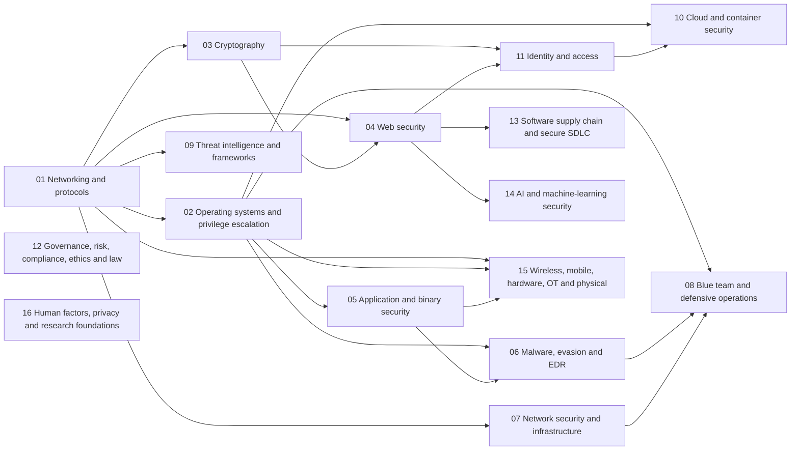

# CyberDojo

A cybersecurity course from absolute zero, built from the 24-month roadmap PDF.

```
pnpm install
pnpm dev        # http://localhost:3100
pnpm test       # simulators vs real tools, missions, drills, content rules, build, accounts
pnpm build      # production build
pnpm start      # production server on port 3100
pnpm user:reset <name>   # forgotten password: prints a one-time one
```

Needs Node 22.13 or newer, for the built-in SQLite. It runs on a Node server, not as a static export.

- `modules/<domain>/*.md`: the Master's-level modules. `scripts/coverage/`: the audit behind the coverage matrix.
- `content/lessons/*.md`: lessons, numbered in teaching order. `content/guides/*.md`: Parts A–N of the roadmap.
- `content/machines/*.md`: simulated attack-and-defend machines. `content/reference/*.md`: printable cheat sheets.
- `src/lib/content.ts`: the document format (questions, drills, missions, glossary terms, callouts).
- `src/lib/shell/`: the browser terminal: a shell, filesystem and commands.
- `src/lib/missions/`: graded terminal missions, and the machines in `machines.ts`. `src/lib/drills/`: generated exercises.
- `src/lib/missions/dojo/` and `src/data/dojo.ts`: the Dojo's 54 flag challenges. See `THIRD_PARTY_NOTICES.md`.
- `src/data/*.json`: the 24 months, 16 projects and resources, parsed from the PDF.
- `content/projects/*.md`: each step has `@goal`, `@search` and `@docs`. Walkthroughs are off until the student turns them on.
- `src/server/`, `src/app/api/`: accounts. `src/lib/account.ts`: sync. `src/lib/merge.ts`: combining two copies.

## Modules: the Master's-level reference

The 78 lessons make a junior defender, in order, over 24 months. `modules/` is the reference that sits beside them: one folder per domain, each module running from fundamentals to advanced, always in the same seven parts (Concept, Threat model, Tools, Defence, Pitfalls, Exercise, Further reading). `pnpm test` enforces that template. It also fails on broken links and one-way attack and defence links, on an exercise with no lab notice, and on anything that looks like a working attack recipe.

Modules teach how an attack works, what it leaves behind and how to stop it. They hold no working exploits, payloads or evasion steps, and hands-on offensive practice belongs on legal platforms such as PortSwigger, pwn.college and Hack The Box.

Offensive topics are covered from the defender's side. Active Directory attack techniques and exploit development aren't here on purpose: lessons 44, 45 and 57 cover those at concept level, and the matrix shows them as open.

### Learning path

1. Follow the [Roadmap](/roadmap/) first. It teaches the basics that modules assume.
2. Read a module when its "Read first" list is familiar. Foundation modules are safe from about Month 3.
3. Start with Networking, then Operating systems and Cryptography, which everything else builds on.
4. Pick your depth from there: Web, Blue team or Cloud, following the map below.
5. Finish each module's exercise in your own lab. Reading alone doesn't count.

### Coverage matrix

<!-- coverage:start -->
**534 topics.** Before the modules: 162 present, 125 partial, 247 missing. Now: **504 present, 25 partial, 5 missing.** Every row and its evidence is in [COVERAGE.md](COVERAGE.md).

| Domain | Before ● ◐ ○ | Now ● ◐ ○ | Modules |
|---|---|---|---|
| [01 Networking and protocols](modules/01-networking/README.md) | 17 · 20 · 31 | 66 · 2 · 0 | 14 |
| [02 Operating systems and privilege escalation](modules/02-operating-systems/README.md) | 18 · 20 · 26 | 52 · 8 · 4 | 10 |
| [03 Cryptography](modules/03-cryptography/README.md) | 8 · 11 · 25 | 43 · 1 · 0 | 12 |
| [04 Web security](modules/04-web/README.md) | 26 · 14 · 20 | 57 · 3 · 0 | 14 |
| [05 Application and binary security](modules/05-binary/README.md) | 1 · 4 · 36 | 34 · 6 · 1 | 10 |
| [06 Malware, evasion and EDR](modules/06-malware-edr/README.md) | 8 · 9 · 11 | 27 · 1 · 0 | 7 |
| [07 Network security and infrastructure](modules/07-network-security/README.md) | 9 · 3 · 14 | 26 · 0 · 0 | 7 |
| [08 Blue team and defensive operations](modules/08-blue-team/README.md) | 17 · 9 · 8 | 34 · 0 · 0 | 9 |
| [09 Threat intelligence and frameworks](modules/09-threat-intel/README.md) | 9 · 4 · 14 | 26 · 1 · 0 | 5 |
| [10 Cloud and container security](modules/10-cloud/README.md) | 11 · 10 · 10 | 31 · 0 · 0 | 7 |
| [11 Identity and access](modules/11-identity/README.md) | 13 · 4 · 6 | 23 · 0 · 0 | 5 |
| [12 Governance, risk, compliance, ethics and law](modules/12-grc/README.md) | 9 · 7 · 10 | 25 · 1 · 0 | 7 |
| [13 Software supply chain and secure SDLC](modules/13-supply-chain/README.md) | 7 · 3 · 3 | 13 · 0 · 0 | 3 |
| [14 AI and machine-learning security](modules/14-ai-security/README.md) | 7 · 4 · 0 | 10 · 1 · 0 | 1 |
| [15 Wireless, mobile, hardware, OT and physical](modules/15-wireless-mobile-hardware-ot/README.md) | 0 · 1 · 22 | 22 · 1 · 0 | 9 |
| [16 Human factors, privacy and research foundations](modules/16-human-privacy-research/README.md) | 2 · 2 · 11 | 15 · 0 · 0 | 7 |
<!-- coverage:end -->

### Prerequisites map

Domains, in the order that they depend on each other. The module-by-module table is in [modules/README.md](modules/README.md).

<!-- prereqs:start -->

<!-- prereqs:end -->

## Accounts

Guests keep progress in the browser. An account keeps it on the server, in one SQLite file (`data/cyberdojo.db`, or `CYBERDOJO_DB`). Back that file up. Sign-up needs a username only, so a forgotten password is reset with `pnpm user:reset`.

## Usage statistics

The site counts its own visits, in the same SQLite file: no outside service, no IP address, no user agent. A browser gets a random number, kept in `localStorage`; it reports each page opened and the seconds the tab was visible and in use. The server groups those into visits (a visit ends after 30 minutes of silence) and never credits more time than really passed. Rows older than 400 days are deleted.

- Name the admins in `CYBERDOJO_ADMINS` (usernames, comma-separated). They get a link on their account page to `/admin/`: accounts, visitors, average time per visit and per person, day-by-day charts, a line per account, the most-read pages. Everyone else gets a 404 from `/api/admin/stats/`.
- Create the admin account **before** you set the variable on a public server, or whoever registers that username first becomes the admin.
- People can switch counting off on the account page. Browsers that send Do Not Track or Global Privacy Control, and automated browsers, aren't counted at all, so the figures are a floor, not an exact count.
- `src/server/metrics.ts` (recording and the report), `src/lib/track.ts` (the browser side), `scripts/check-metrics.ts` (`pnpm test:metrics`).

To host it: run behind HTTPS (off `localhost`, session cookies are `Secure`, so plain HTTP can't sign in), keep `data/` on a persistent disk, run one instance, and set `TRUST_PROXY=1` only behind a proxy you control, or rate limits by IP can be spoofed. Serverless hosts such as Vercel don't fit: they have no persistent disk.
