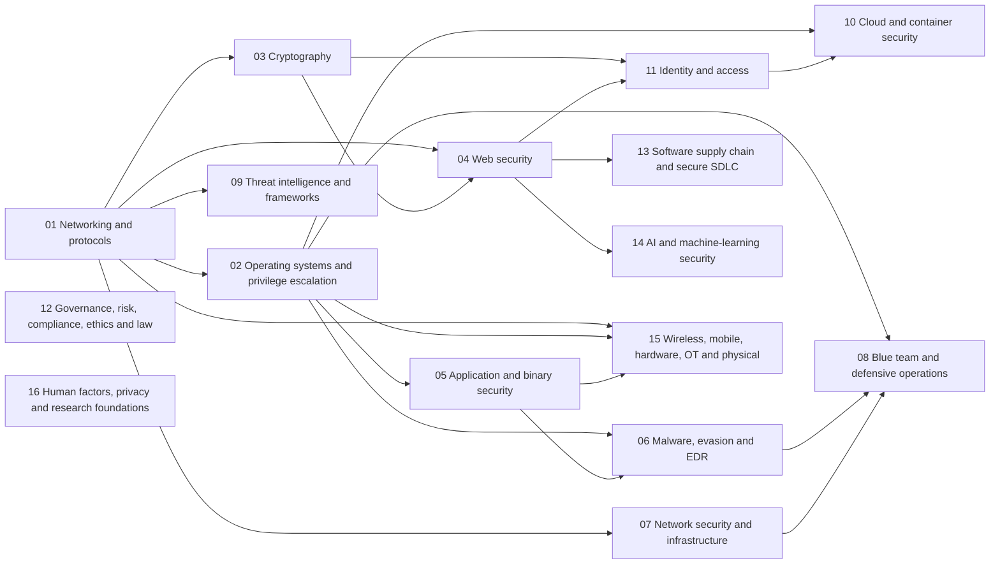

# CyberDojo

A cybersecurity course from absolute zero, built from the 24-month roadmap PDF. Read it on the website, [cyberdojo-beta.vercel.app](https://cyberdojo-beta.vercel.app), or [download the desktop app](https://cyberdojo-beta.vercel.app/download/) for Windows, macOS and Linux: the whole course offline, with an AI tutor that runs on your computer.

```
pnpm install
pnpm dev        # http://localhost:3100
pnpm test       # simulators vs real tools, missions, drills, content rules, build, accounts
pnpm build      # production build
pnpm start      # production server on port 3100
pnpm user:reset <name>   # forgotten password: prints a one-time one
```

Needs Node 22.13 or newer, for the built-in SQLite. It runs on a Node server, not as a static export.

- `modules/<domain>/*.md`: the Master's-level modules. `scripts/coverage/`: the audit behind the coverage matrix.
- `content/lessons/*.md`: lessons, numbered in teaching order. `content/guides/*.md`: Parts A–N of the roadmap.
- `content/machines/*.md`: simulated attack-and-defend machines. `content/reference/*.md`: printable cheat sheets.
- `src/lib/content.ts`: the document format (questions, drills, missions, glossary terms, callouts).
- `src/lib/shell/`: the browser terminal: a shell, filesystem and commands.
- `src/lib/missions/`: graded terminal missions, and the machines in `machines.ts`. `src/lib/drills/`: generated exercises.
- `src/lib/missions/dojo/` and `src/data/dojo.ts`: the Dojo's 54 flag challenges. See `THIRD_PARTY_NOTICES.md`.
- `src/data/*.json`: the 24 months, 16 projects and resources, parsed from the PDF.
- `content/projects/*.md`: each step has `@goal`, `@search` and `@docs`. Walkthroughs are off until the student turns them on.
- `desktop/`, `scripts/desktop.ts`: the desktop app's shell and build. `src/server/tutor/`, `src/components/tutor/`: its tutor.
- `src/server/`, `src/app/api/`: accounts. `src/lib/account.ts`: sync. `src/lib/merge.ts`: combining two copies.

## Modules: the Master's-level reference

The 78 lessons make a junior defender, in order, over 24 months. `modules/` is the reference that sits beside them: one folder per domain, each module running from fundamentals to advanced, always in the same seven parts (Concept, Threat model, Tools, Defence, Pitfalls, Exercise, Further reading). `pnpm test` enforces that template. It also fails on broken links and one-way attack and defence links, on an exercise with no lab notice, and on anything that looks like a working attack recipe.

Modules teach how an attack works, what it leaves behind and how to stop it. They hold no working exploits, payloads or evasion steps, and hands-on offensive practice belongs on legal platforms such as PortSwigger, pwn.college and Hack The Box.

Offensive topics are covered from the defender's side. Active Directory attack techniques and exploit development aren't here on purpose: lessons 44, 45 and 57 cover those at concept level, and the matrix shows them as open.

### Learning path

1. Follow the [Roadmap](/roadmap/) first. It teaches the basics that modules assume.
2. Read a module when its "Read first" list is familiar. Foundation modules are safe from about Month 3.
3. Start with Networking, then Operating systems and Cryptography, which everything else builds on.
4. Pick your depth from there: Web, Blue team or Cloud, following the map below.
5. Finish each module's exercise in your own lab. Reading alone doesn't count.

### Coverage matrix

<!-- coverage:start -->
**534 topics.** Before the modules: 162 present, 125 partial, 247 missing. Now: **504 present, 25 partial, 5 missing.** Every row and its evidence is in [COVERAGE.md](COVERAGE.md).

| Domain | Before ● ◐ ○ | Now ● ◐ ○ | Modules |
|---|---|---|---|
| [01 Networking and protocols](modules/01-networking/README.md) | 17 · 20 · 31 | 66 · 2 · 0 | 14 |
| [02 Operating systems and privilege escalation](modules/02-operating-systems/README.md) | 18 · 20 · 26 | 52 · 8 · 4 | 10 |
| [03 Cryptography](modules/03-cryptography/README.md) | 8 · 11 · 25 | 43 · 1 · 0 | 12 |
| [04 Web security](modules/04-web/README.md) | 26 · 14 · 20 | 57 · 3 · 0 | 14 |
| [05 Application and binary security](modules/05-binary/README.md) | 1 · 4 · 36 | 34 · 6 · 1 | 10 |
| [06 Malware, evasion and EDR](modules/06-malware-edr/README.md) | 8 · 9 · 11 | 27 · 1 · 0 | 7 |
| [07 Network security and infrastructure](modules/07-network-security/README.md) | 9 · 3 · 14 | 26 · 0 · 0 | 7 |
| [08 Blue team and defensive operations](modules/08-blue-team/README.md) | 17 · 9 · 8 | 34 · 0 · 0 | 9 |
| [09 Threat intelligence and frameworks](modules/09-threat-intel/README.md) | 9 · 4 · 14 | 26 · 1 · 0 | 5 |
| [10 Cloud and container security](modules/10-cloud/README.md) | 11 · 10 · 10 | 31 · 0 · 0 | 7 |
| [11 Identity and access](modules/11-identity/README.md) | 13 · 4 · 6 | 23 · 0 · 0 | 5 |
| [12 Governance, risk, compliance, ethics and law](modules/12-grc/README.md) | 9 · 7 · 10 | 25 · 1 · 0 | 7 |
| [13 Software supply chain and secure SDLC](modules/13-supply-chain/README.md) | 7 · 3 · 3 | 13 · 0 · 0 | 3 |
| [14 AI and machine-learning security](modules/14-ai-security/README.md) | 7 · 4 · 0 | 10 · 1 · 0 | 1 |
| [15 Wireless, mobile, hardware, OT and physical](modules/15-wireless-mobile-hardware-ot/README.md) | 0 · 1 · 22 | 22 · 1 · 0 | 9 |
| [16 Human factors, privacy and research foundations](modules/16-human-privacy-research/README.md) | 2 · 2 · 11 | 15 · 0 · 0 | 7 |
<!-- coverage:end -->

### Prerequisites map

Domains, in the order that they depend on each other. The module-by-module table is in [modules/README.md](modules/README.md).

<!-- prereqs:start -->

<!-- prereqs:end -->

## Desktop app

The same course as a program for Windows, macOS and Linux, with a tutor that runs on the learner's computer through [Ollama](https://ollama.com). Once the app and a model are installed it needs no connection, apart from the links that lead to outside labs. How it is put together: [docs/ARCHITECTURE.md](docs/ARCHITECTURE.md).

```
pnpm desktop:dev      # the app window on `next dev`, with live reload
pnpm desktop:start    # build everything, then run the built app without an installer
pnpm desktop:dist     # installers for this operating system, in desktop/dist/
pnpm test:tutor       # the tutor's checks (run `pnpm tutor:index` first)
```

An installer can only be built on its own system. `.github/workflows/desktop.yml` builds all three: run it by hand from the Actions tab to get them as workflow files, or publish a release. It produces an NSIS installer (Windows x64), a dmg and zip (macOS, Apple silicon), and an AppImage and deb (Linux x64). The file names carry no version, so `releases/latest/download/<name>` always points to the newest.

**Releasing.** Raise `version` in `package.json`, commit, then push a tag that matches it: `git tag desktop-v0.2.0 && git push origin desktop-v0.2.0`. The workflow checks the two agree, builds the three systems, and one last job publishes them as a GitHub release with `SHA256SUMS.txt` and generated release notes. The website's `/download/` page reads the newest `desktop-v*` release from GitHub every ten minutes, so it offers the new installers without a redeploy, and the app's Help menu tells existing users. The page is open to everyone; the rest of the site stays members-only.

**Signing.** The installers aren't signed with a paid certificate, so both systems warn on first launch, and `/download/` walks through it with the exact words each one shows. Windows: "Windows protected your PC", then More info, Run anyway. macOS (the app is signed ad hoc, since Apple silicon runs nothing unsigned, but not notarised): "Apple could not verify…", choose Done, not Move to Trash, then System Settings, Privacy & Security, Open Anyway; if macOS calls the app damaged, `xattr -dr com.apple.quarantine /Applications/CyberDojo.app`. Removing the warnings needs an Apple Developer Program membership (notarisation) and a Windows code-signing certificate, or publishing through the Microsoft Store.

### The tutor

On first launch the app opens on **Your AI tutor** (`/tutor/setup/`). It shows what the computer has (memory, graphics card, free disk), recommends a model, and one button does the rest in the background:

1. **Ollama.** If it is already running, it is used. If it is installed but stopped, the app starts it. If it is missing, the app installs it from Ollama's own GitHub release, after checking the file against the release's SHA-256 list:
   - Windows: `OllamaSetup.exe`, run silently for this user only (no administrator rights), only if its signature is Ollama Inc.'s. This is what Ollama's `install.ps1` does.
   - macOS: `Ollama.app`, unpacked into Applications, only if macOS accepts its signature and notarisation.
   - Linux: the official build, unpacked into the app's data folder, because the system install needs sudo. The app starts this copy and stops it when it quits.
2. **The model** the learner chose, then the course search model, `nomic-embed-text` (0.3 GB). The course is then indexed once.

The learner can keep studying during the download: the Tutor button in the top bar shows the progress. Quitting while a download runs asks first. Once the tutor is set up, the app starts Ollama by itself at each launch if it isn't running.

**Which model.** Each model is marked fast, usable, slow or too large for this computer, from its exact download size, the memory, and the graphics card (NVIDIA cards through `nvidia-smi`; Apple silicon shares its memory). The recommendation is the largest of `qwen3.5:2b`, `qwen3.5:4b`, `qwen3.5:9b`, `gemma4:12b` and `qwen3.5:27b` that runs fast:

| This computer | Recommended | Download |
| --- | --- | --- |
| 8 to 16 GB of memory, no graphics card | `qwen3.5:4b` | 3.3 GB |
| A graphics card with 6 to 8 GB | `qwen3.5:4b`; the 9b also runs, partly on the processor | 3.3 GB |
| A graphics card with 10 to 19 GB, or a Mac with 16 or 24 GB | `gemma4:12b` | 8.0 GB |
| A graphics card with 20 GB or more, or a Mac with 32 GB or more | `qwen3.5:27b` | 17.5 GB |

The list also has `llama3.2:3b`, `gemma4:e4b`, `gpt-oss:20b` (a mixture-of-experts model that stays usable without a graphics card) and `gemma4:26b`. Any other Ollama model can be downloaded by name, and models can be deleted to free space. Thinking models (Qwen 3.5, gpt-oss) have their long reasoning switched off or set low, so answers start in seconds.

**Using it.** The tutor opens from the corner of every page, having read the page that is open; it gives hints before answers and has four modes: Explain, Hint, Review my work, Quiz me. Every "Ask the tutor" button sends it the question, your answer and the key. Under each written question, "Grade my answer" grades it against the section and keeps the grade. **Ask the tutor** (`/tutor/`, Ctrl+T) is the tutor on its own page, for any question, with your chats listed beside it. Select text on any page and right-click "Ask the tutor about this".

**The window.** It reopens at its last size and place, on the last page read. The menus have shortcuts: Ctrl+1 to 5 for Roadmap, Lessons, Practice, Progress and the tutor; Alt+Left and Alt+Right (Cmd+[ and Cmd+] on a Mac), or the mouse's side buttons, go back and forward.

**Updates.** The app checks the project's public GitHub releases once a day and from Help, Check for updates. Nothing about the learner is sent. On Windows and the Linux AppImage, which can replace themselves without a paid certificate, a newer version downloads in the background (`electron-updater`) and the app offers to restart, or installs it on the next quit. On macOS (self-update needs an Apple-signed build) and the Debian package (apt manages it), the app instead shows a notice and opens the release page to download by hand. Either way, progress, chats and the tutor's models stay where they are; a release that changes the course reaches app users at their next update, website users on the next deploy.

Everything is stored in one SQLite file in the app's data folder (`%APPDATA%\CyberDojo`, `~/Library/Application Support/CyberDojo`, `~/.config/CyberDojo`): progress, chats, grades, settings and the search index. Back up `cyberdojo.db` to keep them. The same folder holds `logs/` and, on Linux, the Ollama copy the app installed. Models live where Ollama keeps them (`~/.ollama/models`), shared with any other Ollama on the computer.

### Adding content

Write the Markdown file where its kind lives (`content/lessons/`, `modules/<domain>/`, `tools/<category>/` and so on) and run `pnpm test:content`. The website shows it on the next deploy. The desktop app shows it, and the tutor knows it, on the next `pnpm desktop:dist`: the build pre-renders the page and rebuilds the tutor's index from the same file.

## Running your own server

Accounts, the members-only gate, the usage statistics and hosting on Vercel with Turso, or on any Node host, are in [docs/SELF-HOSTING.md](docs/SELF-HOSTING.md). How the desktop app is built: [docs/ARCHITECTURE.md](docs/ARCHITECTURE.md).

## License

The code is under the [MIT license](LICENSE). The course material, the Markdown in `content/`, `modules/` and `tools/`, is under [CC BY-NC-SA 4.0](LICENSE-CONTENT): share and adapt it with credit, not for profit, under the same license. Third-party material is listed in [THIRD_PARTY_NOTICES.md](THIRD_PARTY_NOTICES.md). Contributions: [CONTRIBUTING.md](CONTRIBUTING.md). Vulnerabilities: [SECURITY.md](SECURITY.md).
